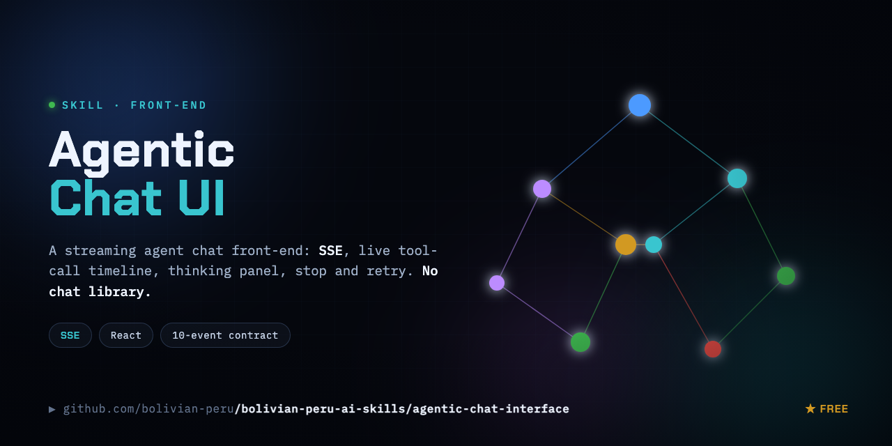

# agentic-chat-interface

A production-grade **streaming agent chat front-end** pattern — SSE-streamed conversation,
live tool-call timeline, collapsible "thinking" panel, stop/retry/abort, graceful failure.
Framework-light: React + `fetch` + the Streams API + Tailwind + lucide. **No chat library,
no SSE library.** No mock data, no fluff.

## Files

| File | What it is |
|---|---|
| [`SKILL.md`](./SKILL.md) | The skill. The full pattern an agent follows to build the interface: the SSE event contract, the stream-consumer loop, the resilience set, the complete animation inventory, the reuse checklist, and the anti-patterns. Start here. |
| [`EVENT-CONTRACT.md`](./EVENT-CONTRACT.md) | Standalone quick-reference for the 10-event SSE contract — the decoupling seam between any agent backend and any chat front-end. Hand this to whoever owns the other side. |

## The one idea

The front-end and the agent backend are decoupled by **one well-defined SSE event contract**
(10 event types). Get it right and you can swap either side freely:

- **Backend** only has to *emit* the 10 events (`status`, `phase`, `tool_use`, `tool_result`,
  `interim_text`, `text`, `text_bulk`, `interim_commit_final`, `error`, `done`).
- **Front-end** only has to *consume* them.

Two text channels — `interim_text` (planning, in a collapsible panel) and `text` (the clean
final answer) — are what stop the UI becoming a wall of reasoning. Don't collapse them.

## Use it

Drop this folder into your agent (`.claude/skills/`, or paste `SKILL.md` into Cursor/Copilot)
and ask: **"Follow this skill to build a streaming chat UI for my agent backend."** The agent
will stand up the client component (stream consumer + animated timeline + composer) and the
server SSE route, wired by the event contract — then you re-skin the `TOOL_META` registry,
the copy, and the theme tokens for your product.

## What to copy vs. swap

- **Copy verbatim:** the event contract, the consume loop, the resilience set (AbortController
  + 60s stall watchdog + heartbeat skipping + retry + graceful pre-stream 401), and the
  near-bottom-only auto-scroll.
- **Swap per product:** `TOOL_META` (your tools/icons/verbs/tones), the quick-prompts + copy,
  the backend URL + request body, the markdown link targets, and optional auth/persistence.

MIT.
