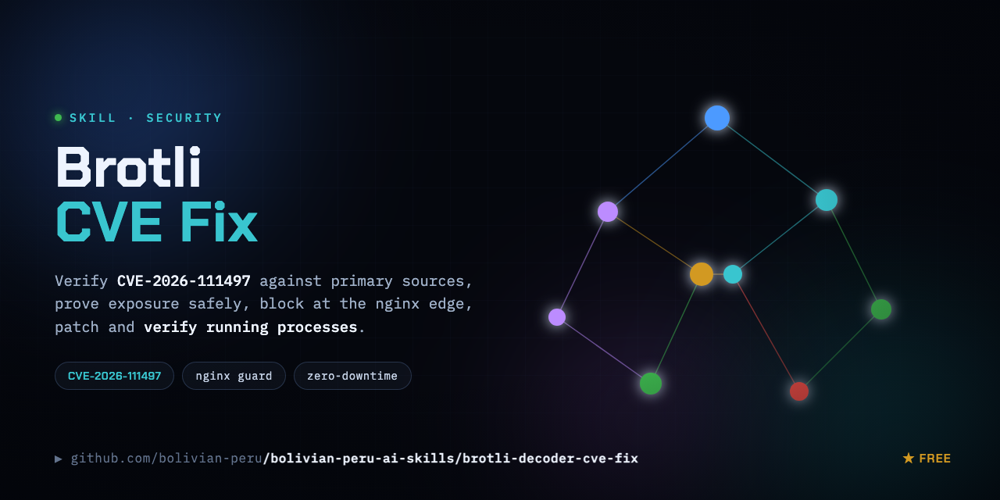

# brotli-decoder-cve-fix

Verify CVE-2026-111497 against primary sources, prove exposure safely, block at the nginx edge, patch and verify running processes.

The skill itself is [SKILL.md](SKILL.md); helper files sit next to it.
