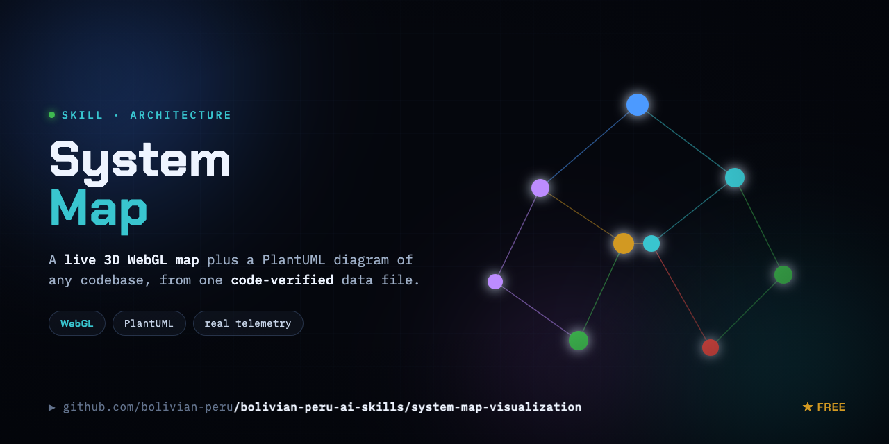

# system-map-visualization

Build a **live, animated 3D WebGL system map** + a **static PlantUML architecture diagram**
of any software project — from one code-verified data file. No mock data, no fluff.

## Files

| File | What it is |
|---|---|
| [`SKILL.md`](./SKILL.md) | The skill. The full prompt + spec an agent follows to build both artifacts on YOUR repo. Start here. |
| [`gen-diagram.mjs`](./gen-diagram.mjs) | The PlantUML generator — reads `ecosystem-data.json`, emits a `.puml` + a plantuml.com render URL (raw-deflate + custom base64). Generic; set `PROJECT_TITLE`. |
| [`ecosystem-data.json`](./ecosystem-data.json) | An **example** data file (generic 3-tier web app) so the generator runs immediately. Replace it with one generated from your real code. |

## Quick start (the diagram, in 30 seconds)

```bash
PROJECT_TITLE="My App" node gen-diagram.mjs
curl -s "$(cat ecosystem-plantuml-url.txt)" -o ecosystem-diagram.svg
open ecosystem-diagram.svg   # or embed via the diagram.html pattern in SKILL.md
```

## Use the skill (the full map)

Drop this folder into your agent (`.claude/skills/`, or paste `SKILL.md` into Cursor/Copilot)
and ask: **"Follow this skill to build a live system map of THIS repo."** The agent will:

1. **Deeply analyze** your real source/config — entrypoints, services, datastores, infra,
   external deps, frontends — and verify every node/edge against a real file.
2. Find your **public, safe (counts/status) endpoints** for the real-time layer.
3. Emit `ecosystem-data.json`, then build a self-contained `index.html` (orbiting WebGL
   graph, live telemetry, clickable subsystems, guided journeys) + `diagram.html` (PlantUML).
4. Verify it renders (headless), then it's deployable to any static host.

**The rule it never breaks:** every node, edge, and number is verified against real code or a
live endpoint. If it can't be verified, it isn't shown.

MIT.
